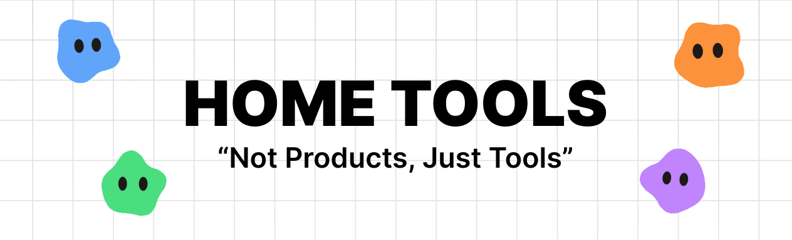

<p align="center">
  
</p>

<h1 align="center">Home Tools</h1>

<p align="center">
  Small self-hosted tools for one household. Tools, not a product.
</p>

<p align="center">
  
  
  
  
  
  
  <br>
  
  
  
  
  
</p>

---

Running on a home server, reachable only on the home network. **No accounts,
no tracking, no lock-in.** All data is plain JSON files you can read, edit
and back up by copying a folder.

Everyone picks their profile Netflix-style; there are no passwords (it's a
trusted home network).

## Tools

| Tool | Address | What it does |
| --- | --- | --- |
| **Fitness** | `fitness.<domain>` | Plans, a weekly routine per person, workout logging built for a phone at the gym (pre-filled sets, rest timer, exercise photos and instructions, cardio with time and distance), weekly body-weight check-ins. 876 exercises from [free-exercise-db](https://github.com/yuhonas/free-exercise-db) (public domain). |
| **Game servers** | `games.<domain>` | Status, start/stop/restart and live logs for the household's Minecraft and Valheim servers (Docker containers, reached through a filtered socket proxy), who's online, joins and leaves, a Minecraft console and whitelists. |
| **Discord** | `discord.<domain>` | The household's Discord bot and its settings: `/sens` (sensitivity between games), `/restart` and `/whitelist` for verified people, live server statuses in a channel, and a blob avatar with a new name and color every day. |
| **Home Tools** | `tools.<domain>` | One page with a shortcut to every tool, so there's one thing to bookmark. |

## Stack

- **Backend:** Go (standard library first) serving a JSON API and the web apps, built into one binary
- **Frontend:** Svelte 5 + Vite + TypeScript, no SSR
- **Storage:** JSON files, written atomically
- **Deploy:** Docker image behind Caddy for HTTPS

Why each of these: [`docs/decisions/`](docs/decisions/).

## Run it locally

> **Needs** Go 1.27+, Node 24+ and pnpm 10.

```sh
pnpm --dir web install
go run ./cmd/fitness-import -data data/fitness -users data/users   # catalog + photos, ~30 s
```

| Command | Runs |
| --- | --- |
| `make run` | API on `:8080` (data in `./data`). One tool: `TOOL=fitness` (default), `games`, `discord` or `tools` |
| `make web` | Fitness UI on <http://localhost:5173> (proxies the API) |
| `make web-games` | Games UI on <http://localhost:5174> |
| `make web-discord` | Discord settings on <http://localhost:5175> (bot needs `DISCORD_TOKEN`) |
| `make web-tools` | Tools home page on <http://localhost:5176> (no API) |

Before committing:

```sh
make check
pnpm --dir web check
```

## Deploy

```
push to main  →  GitHub Actions runs checks  →  images published to GHCR  →  update the app on the server
```

Setup (HTTPS certificate, local DNS, ZimaOS apps) and day-to-day tasks:
[`deploy/README.md`](deploy/README.md).

## Layout

```
cmd/home-tools/       the server: loads data, mounts tools, serves the apps
cmd/fitness-import/   imports the exercise catalog
internal/             shared Go: profiles (users), JSON files, HTTP helpers
tools/fitness/        fitness: model, rules, store, API
tools/games/          game servers: config, Docker API client, API
tools/discord/        Discord bot: commands, status boards, persona, settings API
web/packages/ui/      shared UI: tokens, styles, components, profiles
web/apps/fitness/     fitness web app (Svelte)
web/apps/games/       games web app (Svelte)
web/apps/discord/     Discord settings web app (Svelte)
web/DESIGN.md         UI rules: tokens, accessibility, shared pieces
deploy/               Docker, Caddy, ZimaOS app files
docs/                 decisions (ADRs), how to add a tool
data/                 runtime JSON (not in git)
```

## Working on it

[`AGENTS.md`](AGENTS.md) is the guide for anyone (human or AI) changing the
code: principles, conventions, the decision log and current status. Each
tool has its own `AGENTS.md`.

Adding a tool? See [`docs/adding-a-tool.md`](docs/adding-a-tool.md).
